

# سيناريو موثّق — «مجموعة آفاق المستقبل القابضة» على مدار للمؤسسات

جولة حقيقية من البداية إلى النهاية: موظف يفتح تطبيق مدار لأول مرة، ينضم إلى خادم مؤسسته المستضاف ذاتياً، يعمل داخل القنوات والذاكرة المؤسسية، ثم يسجّل خروجه. كل لقطة شاشة هنا التقطها اختبار آلي من شاشات التطبيق الفعلية وهي تتحدث إلى خادم يعمل، وليست تصميماً.

> **إعادة التوليد في أي وقت:** `flutter test test/live_afaq_scenario_test.dart` من مستودع تطبيق مدار
> يعيد الاختبار تهيئة المؤسسة التجريبية بنفسه (`bin/seed-demo.js`) ثم يلتقط اللقطات الأربع عشرة إلى `docs/scenarios/afaq_holding_e2e/`.

---

## المؤسسة التجريبية

تُنشئها `node bin/seed-demo.js --force` من جذر المستودع (تمحو بيانات المؤسسة الموجودة):

| البند | القيمة |
| :--- | :--- |
| المؤسسة | **مجموعة آفاق المستقبل القابضة** |
| الأقسام | الإدارة التنفيذية • إدارة تطوير الأنظمة والمنتجات • الموارد البشرية • الشؤون المالية |
| القنوات | قناة لكل قسم • «التعاميم الرسمية» (النشر للإدارة فقط) |
| المحتوى | محادثة افتتاحية وقرار معتمد ومتابعة مسندة ومرجع مثبّت في قناة التطوير، وتعميمان رسميان |
| رمز الانضمام | `MADAR-ENR-DEMO-0001` (متعدد الاستخدام، صالح سنة) |

> كلمات المرور أدناه هي افتراضيات `bin/seed-demo.js` للتجربة المحلية. النسخة العامة على `workspace.protosoftdev.online` تستخدم كلمات مرور مختلفة.

| الموظف | الرقم الوظيفي | الدور | كلمة المرور التجريبية |
| :--- | :--- | :--- | :--- |
| أ. نورة السبيعي | `EMP-100` | `SUPER_ADMIN` — لوحة الإدارة | `Madar#Admin2026` |
| م. سلطان الدوسري | `EMP-201` | `DEPT_HEAD` — الموظف في هذه الجولة | `Madar#Staff2026` |
| أ. ريم القحطاني | `EMP-202` | `MEMBER` | `Madar#Staff2026` |
| أ. هند الزهراني | `EMP-301` | `DEPT_HEAD` | `Madar#Staff2026` |

> بيانات تجريبية للتقييم فقط. بدّلها قبل تعريض الخادم لأي شخص خارج جهازك.

---

## الجولة

### 1. البوابة الحيادية
قبل أي تسجيل دخول لا يعرف التطبيق أي خادم: عنوان سحابة الأفراد مختوم، ولا عنوان مؤسسة بعد. يختار الموظف **«مساحة عمل مؤسسة»**، ويتحقق الاختبار أن هذا الاختيار لا يفك ختم عنوان سحابة الأفراد.

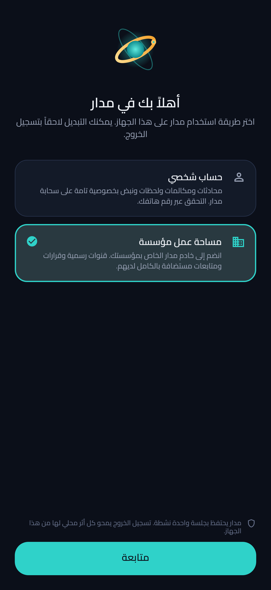

### 2. مساحة العمل قبل الانضمام
لا بيانات وهمية ولا أسماء مؤسسات افتراضية — فقط «لم تنضم إلى أي مؤسسة بعد».

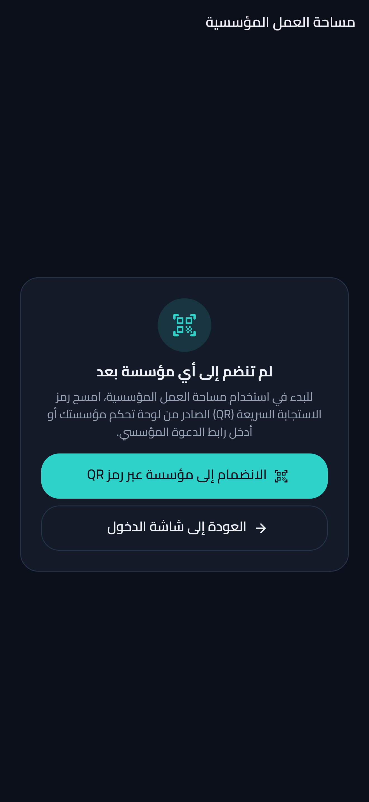

### 3. مسح رمز الانضمام
يقرأ التطبيق رابط `madar://enroll` من رمز QR الذي أصدرته لوحة الإدارة، ويعبّئ اسم المؤسسة وعنوان خادمها والرقم الوظيفي والقسم. قبل إرسال أي بيانات يقرأ `/.well-known/madar-workspace.json` ليتأكد من هوية المؤسسة.

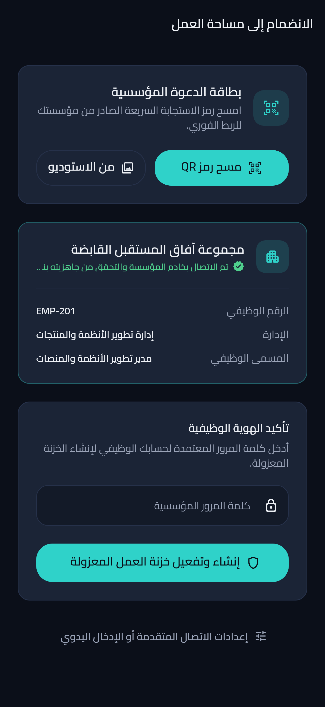

### 4. مركز الاهتمام
بعد الانضمام يصبح التطبيق عميل هذه المؤسسة وحدها: الجلسة في الوضع المؤسسي، ولا أثر لأي حساب شخصي.

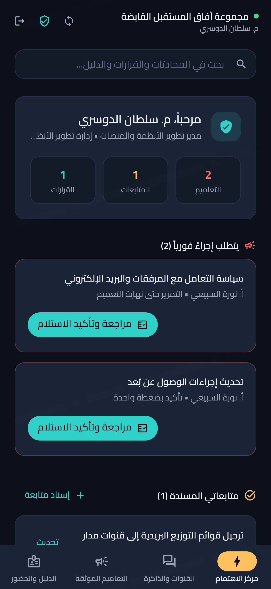

### 5. المحادثة في قناة القسم
الحوار يجري في قناة رسمية بدل سلسلة رسائل بريد. الرسالة الأخيرة أرسلها الموظف أثناء الجولة نفسها.

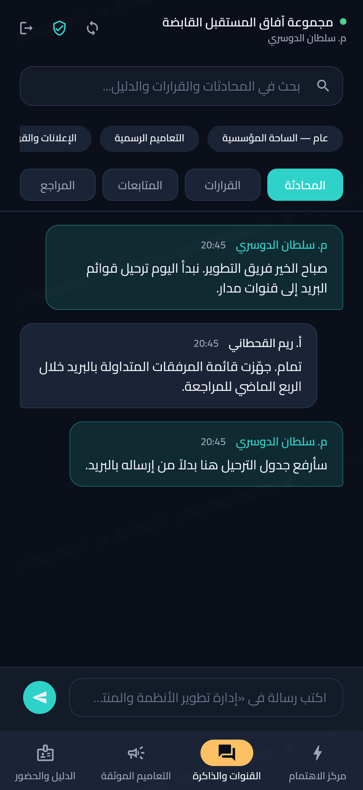

### 6. سجل القرارات
القرار المعتمد يبقى في القناة بمبرراته، لا في صندوق بريد شخص واحد.

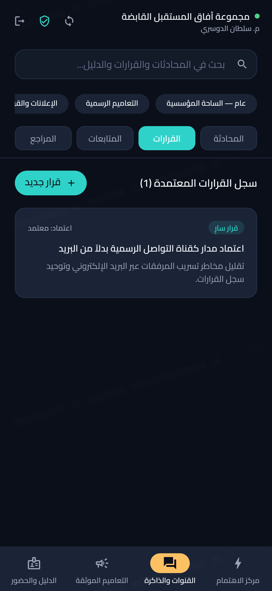

### 7. المتابعات المسندة
كل متابعة لها مسؤول وموعد.

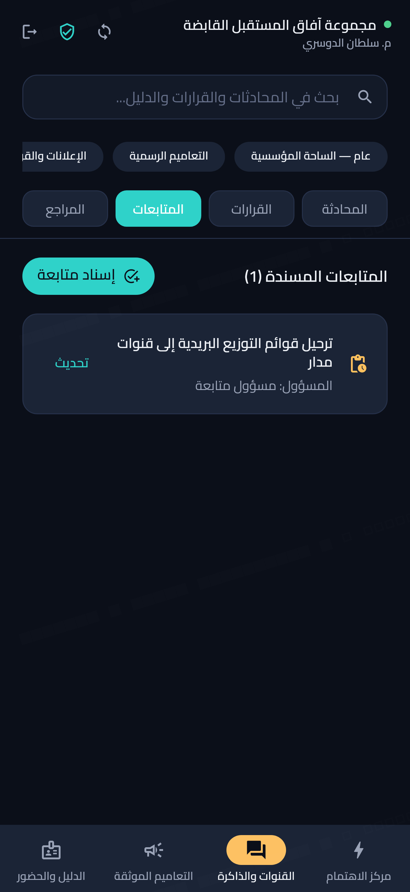

### 8. المراجع المثبّتة
الوثيقة المعتمدة مثبّتة في القناة بدل أن تُرسل مرفقاً.

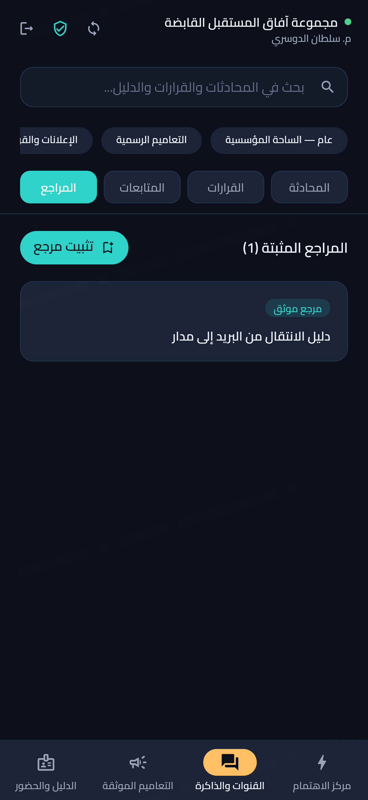

### 9. التعاميم الرسمية
تعميم «سياسة التعامل مع المرفقات والبريد الإلكتروني» يتطلب تأكيد الاطلاع، ونصّه محفوظ مشفّراً على خادم المؤسسة.

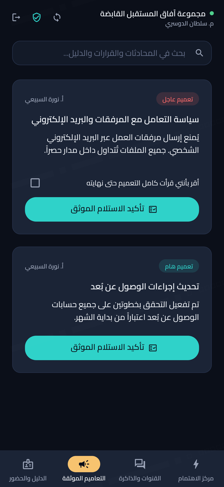

### 10. الدليل والحضور
الزملاء من سجلات المؤسسة نفسها، وحالة الموظف «في اجتماع» ظاهرة لهم.

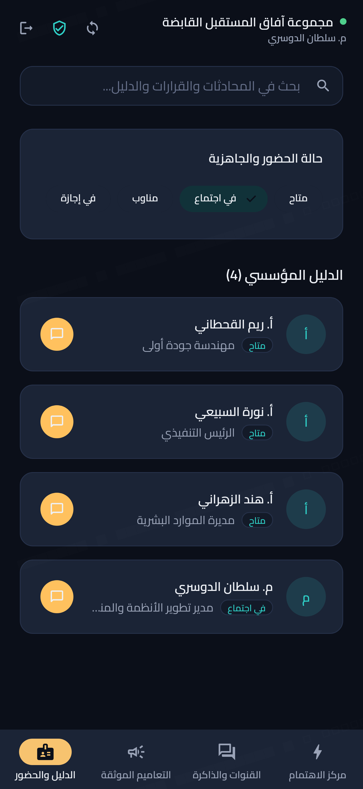

### 11. مراسلة زميل مباشرة
«أرسلي لي ملف المرفقات هنا وليس على البريد» — المحادثة المباشرة داخل مساحة العمل.

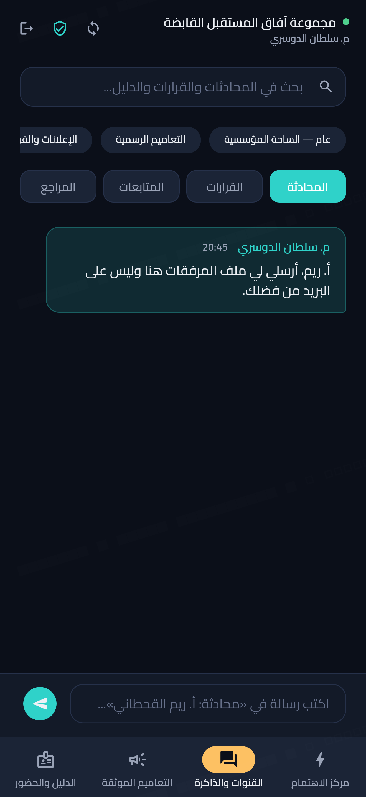

### 12. البحث الموحّد
بحث واحد في المحادثات والقرارات والدليل.

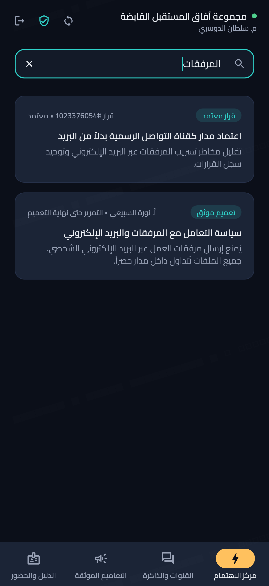

### 13. ما تديره مؤسستي
شفافية تجاه الموظف: ما تملك المؤسسة رؤيته وإدارته، وما لا تملكه أبداً.

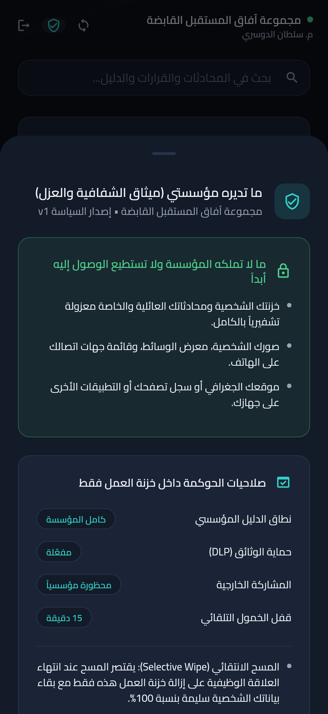

### 14. تسجيل الخروج يعيد التطبيق إلى البوابة
قبل الخروج يتحقق الاختبار أن عنوان سحابة الأفراد بقي مختوماً طوال الجلسة، وأن أي طلب لواجهة الأفراد رُفض محلياً (`mode_locked`) دون أن يغادر الجهاز. ثم يمحو تسجيل الخروج كل أثر محلي للجلسة ويعود التطبيق حيادياً، جاهزاً لحساب شخصي أو لمؤسسة أخرى.

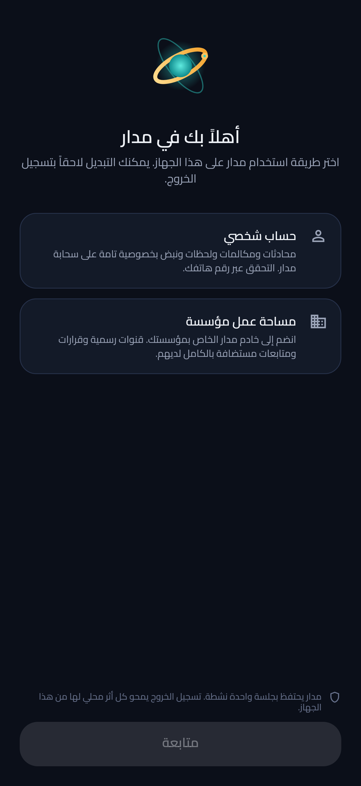

---

## ما الذي يتحقق منه الاختبار، لا الصور فقط

- البوابة لا تحمل أي عنوان خادم قبل الاختيار، واختيار المؤسسة لا يفك ختم سحابة الأفراد.
- الانضمام برمز وكلمة مرور حقيقيين على خادم يعمل، واسم الموظف ودوره من سجلات المؤسسة.
- لا يظهر أي أثر لحساب شخصي داخل جلسة المؤسسة.
- واجهة الأفراد مقفلة طوال الجلسة: الطلب يفشل محلياً بـ `mode_locked`.
- تسجيل الخروج يعيد الوضع إلى «بلا جلسة» ويمسح عنوان خادم المؤسسة.

اختبار الخادم المقابل — الانضمام والقنوات والتعاميم وغياب جداول الأفراد من المخطط — في `madar_server/test/enterprise_e2e.test.js`.

